# 🏢 Enterprise SQL Data Warehouse & ETL Pipeline
### Production-Grade Medallion Architecture (Bronze ➔ Silver ➔ Gold) with Microsoft SQL Server

[](https://www.microsoft.com/sql-server)
[](https://docs.microsoft.com/sql/t-sql/)
[-00A389?logo=databricks&logoColor=white)](#-end-to-end-architecture)
[](#-gold-layer-star-schema--dimensional-modeling)
[](#-data-quality--validation-framework)
[](LICENSE)

---

## 📌 Executive Summary

Modern enterprise organizations frequently struggle with fragmented data across disparate transactional systems. This project delivers an end-to-end, production-grade **Data Warehouse (DWH)** on **Microsoft SQL Server**, ingesting raw datasets from heterogeneous enterprise sources (**CRM** and **ERP** systems), cleansing and conforming data in a structured staging environment, and exposing business-ready multidimensional dimensional models (**Kimball Star Schema**) for reporting, analytics, and business intelligence.

The architecture adopts the industry-standard **Medallion Architecture (Bronze ➔ Silver ➔ Gold)** design pattern:
1. **Bronze Layer (Raw Ingestion):** Scalable, high-throughput bulk ingestion (`BULK INSERT`) of transactional source data with zero loss and schema fidelity.
2. **Silver Layer (Cleansed & Conformed):** Enterprise data cleansing, deduplication, surrogate handling, data standardization, type casting, and audit logging.
3. **Gold Layer (Analytical Star Schema):** Kimball-style dimensional models (`dim_customers`, `dim_products`, `fact_sales`) served via optimized SQL views with surrogate keys and business logic.

---

## 🏛 End-to-End Architecture

The data warehouse centralizes disparate systems into an analytical single source of truth:


*Figure 1: High-Level Architecture showing the multi-tier transition from Source CSVs to Bronze, Silver, and Gold presentation layers.*

### Architectural Paradigm Evaluation

When architecting this data warehouse, multiple industry data architectures were evaluated (Inmon 3NF, Kimball Data Marts, Data Vault 2.0, and Medallion Architecture):

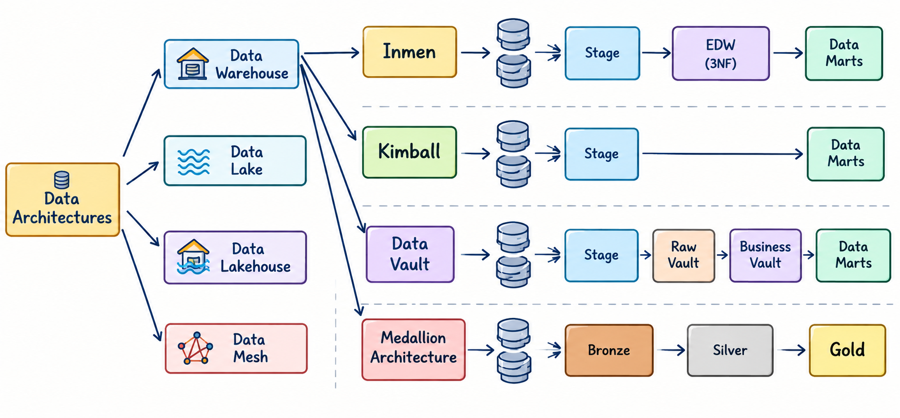
*Figure 2: Data architecture taxonomy and pipeline selection: choosing Medallion Architecture for modern, layered data transformation.*

The **Medallion Architecture** was selected because it balances structured staged refinement, raw historical traceability, and high query performance without the operational complexity of Data Vault or monolithic 3NF dependencies.

---

## 🔄 Source Systems & Entity Relationships

The data warehouse integrates two critical operational systems:
* **Customer Relationship Management (CRM):** Manages front-office customer accounts, product offerings, and sales transaction logs.
* **Enterprise Resource Planning (ERP):** Manages back-office master customer profiles (birthdates, gender), geographical location registries, and product classification hierarchies.

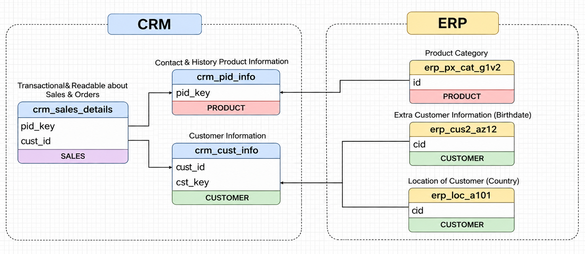
*Figure 3: Cross-system entity relationships between operational CRM and ERP data domains.*

---

## 🛠 ETL Methodology & Pipeline Taxonomy

The Extract, Transform, and Load (ETL) pipeline adheres to industry best practices across extraction methods, transformation operations, and load strategies:

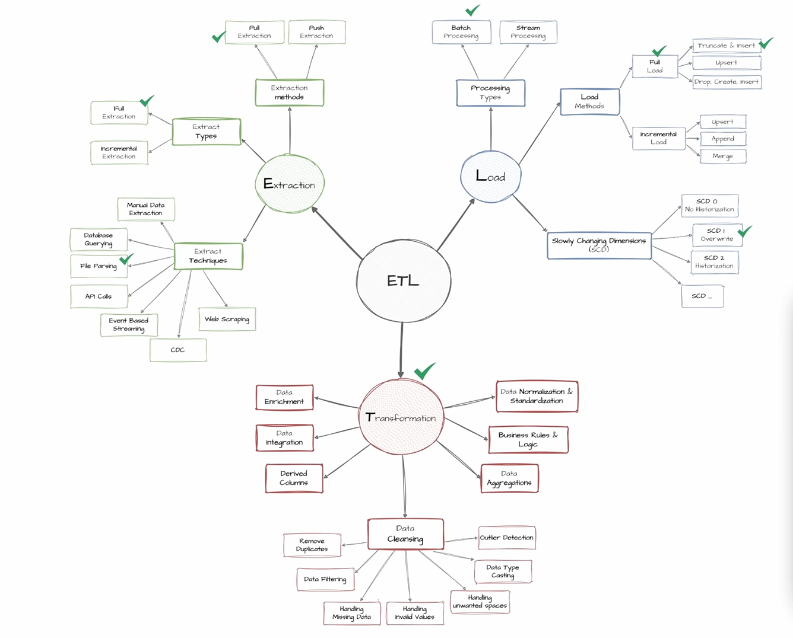
*Figure 4: Comprehensive ETL decision tree highlighting methods utilized in this project (green checkmarks).*

- **Extraction:** Pull-based Full Extraction via file parsing.
- **Transformation:** Whitespace cleansing, deduplication, date derivation via window functions, value standardization, and arithmetic consistency.
- **Load:** Truncate & Load batch processing with SCD Type 1 overwrites.

---

## 🧬 End-to-End Data Lineage & Flow

Data flows methodically through all layers of the warehouse, maintaining clear lineage from source CSV files to final reporting views:

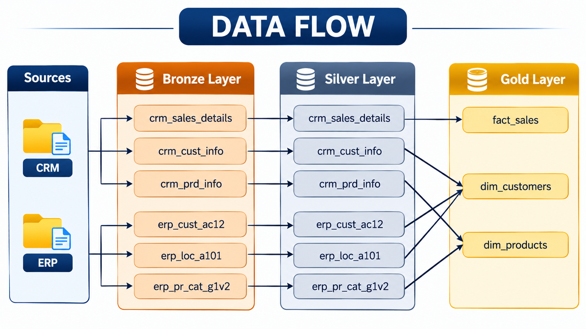
*Figure 5: Detailed table-level data flow mapping across CRM/ERP sources, Bronze tables, Silver tables, and Gold views.*

---

## 🥉 Bronze Layer: Raw Ingestion & Staging

The Bronze Layer is the raw staging area. Source CSV files are loaded into relational tables using SQL Server's native `BULK INSERT` utility for maximum throughput.

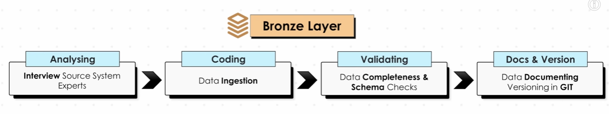
*Figure 6: Bronze Layer operational lifecycle: Analyzing source systems, Coding ingestion, Validating completeness, and Documenting.*

### Ingestion Discovery & Architecture Analysis

Prior to building the pipeline, a comprehensive discovery assessment was performed to determine data ownership, refresh frequency, and performance impact:

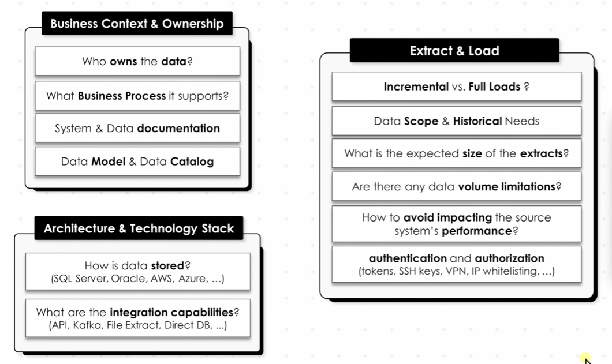
*Figure 7: Ingestion discovery assessment covering Business Context, Technology Stack, and Extract & Load strategies.*

### High-Speed Bulk Loading

Rather than performing slow row-by-row `INSERT` statements, the stored procedure `bronze.load_bronze` executes batch `BULK INSERT` commands with `TABLOCK`:

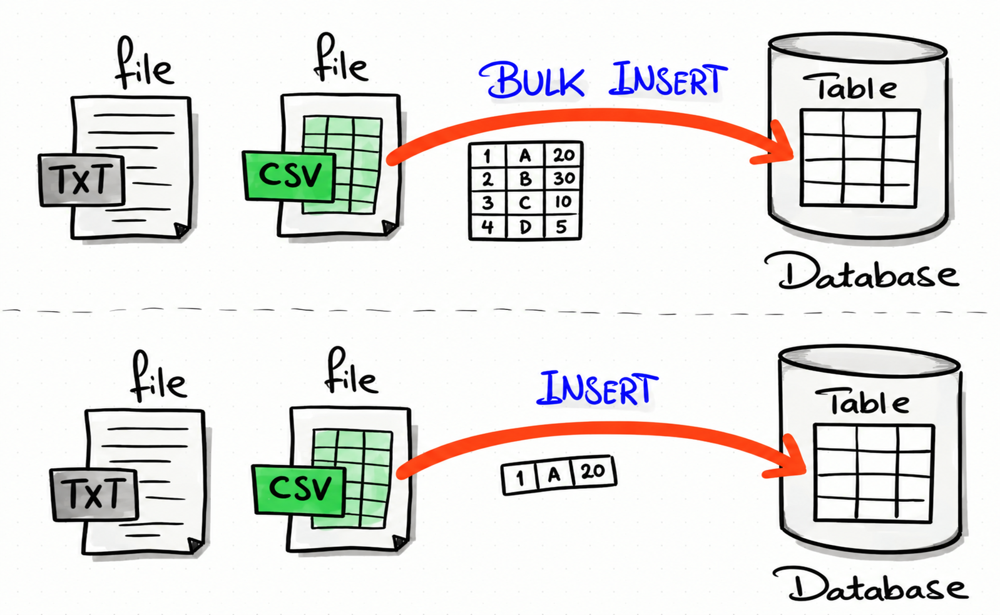
*Figure 8: Performance optimization: Bulk Insert batch stream versus traditional row-by-row iteration.*

```sql
-- Usage: Execute the automated Bronze ingestion procedure
EXEC bronze.load_bronze;
```

**Key Bronze Features:**
- **Full Truncate & Load:** Ensures an idempotent, reproducible baseline.
- **Performance Telemetry:** Calculates and logs load duration in seconds per table and total batch execution time.
- **Resilient Exception Handling:** Wraps ingestion in `TRY...CATCH` blocks with detailed error messages.

---

## 🥈 Silver Layer: Cleansing, Standardizing & Conforming

The Silver Layer cleanses, enriches, deduplicates, and standardizes raw data into high-quality relational tables.

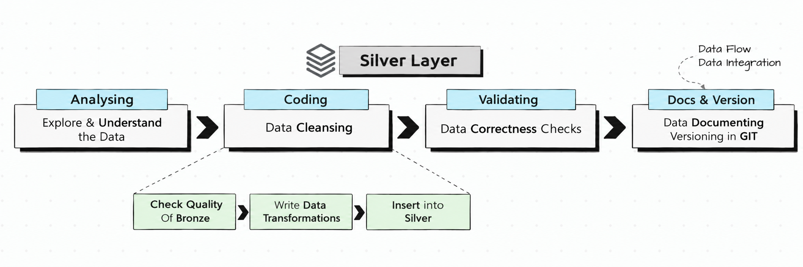
*Figure 9: Silver Layer operational lifecycle: Analyzing anomalies, Coding data cleansing rules, and Validating correctness.*

### Critical Data Cleaning Case Studies

#### 1. Fixing Inverted & Overlapping Product Catalog Dates
In the raw CRM product data (`prd_info`), historical dates were inverted (e.g., `prd_end_dt` occurring before `prd_start_dt`), creating invalid time horizons:

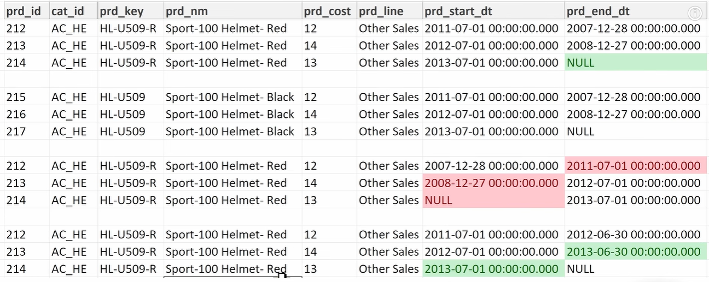
*Figure 10: Step-by-step resolution of inverted product dates using SQL window functions.*

**Resolution:** End dates were dynamically recomputed using the `LEAD()` analytical window function:
```sql
CAST(
    LEAD(prd_start_dt) OVER (PARTITION BY prd_key ORDER BY prd_start_dt) - 1 
    AS DATE
) AS prd_end_dt
```

#### 2. Business Arithmetic & Price Derivation Rules
Raw sales transaction records contained discrepancies where recorded sales did not equal `quantity * price`, negative prices, and missing values:

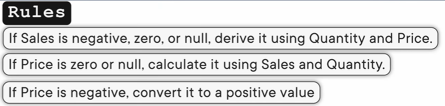
*Figure 11: Business logic rules enforced on sales transactions.*

**Resolution:**
```sql
-- Recalculate sales if missing, negative, or inconsistent with quantity and price
CASE 
    WHEN sls_sales IS NULL OR sls_sales <= 0 OR sls_sales != sls_quantity * ABS(sls_price) 
        THEN sls_quantity * ABS(sls_price)
    ELSE sls_sales
END AS sls_sales,

-- Derive unit price when null or zero
CASE 
    WHEN sls_price IS NULL OR sls_price <= 0 
        THEN sls_sales / NULLIF(sls_quantity, 0)
    ELSE sls_price
END AS sls_price
```

### Comprehensive Data Cleansing Matrix

| Source Table & Column | Raw Data Defect / Challenge | Transformation / Cleansing Logic Applied | Layer / Target |
| :--- | :--- | :--- | :--- |
| `crm_cust_info.cst_id` | Duplicate customer IDs with varying update timestamps | Deduplicated using `ROW_NUMBER() OVER (PARTITION BY cst_id ORDER BY cst_create_date DESC)` where `flag_last = 1`. | `silver.crm_cust_info` |
| `crm_cust_info.cst_firstname`, `cst_lastname` | Inconsistent leading/trailing whitespace (`" Jon"`, `"Yang "`) | Sanitized using `TRIM()`. | `silver.crm_cust_info` |
| `crm_cust_info.cst_marital_status` | Cryptic single-character codes (`'M'`, `'S'`) | Standardized with `CASE`: `'M' ➔ 'Married'`, `'S' ➔ 'Single'`, fallback `'n/a'`. | `silver.crm_cust_info` |
| `crm_cust_info.cst_gndr` | Inconsistent gender codes (`'M'`, `'F'`) | Standardized to `'Male'`, `'Female'`, or `'n/a'`. | `silver.crm_cust_info` |
| `crm_prd_info.prd_key` | Composite key packing Category ID and Product Key (`CO-RF-FR-R92B-58`) | Parsed via `SUBSTRING` and `REPLACE`: extracted `cat_id` (`CO_RF`) and clean `prd_key`. | `silver.crm_prd_info` |
| `crm_prd_info.prd_cost` | Missing and `NULL` product costs | Imputed with `ISNULL(prd_cost, 0)`. | `silver.crm_prd_info` |
| `crm_prd_info.prd_line` | Abbreviated codes (`'M'`, `'R'`, `'S'`, `'T'`) | Mapped to friendly business names: `Mountain`, `Road`, `Other Sales`, `Touring`. | `silver.crm_prd_info` |
| `crm_sales_details.sls_order_dt`, `ship_dt`, `due_dt` | Stored as integer keys (`20101229`) or zeros (`0`) | Validated string length (`LEN = 8`) and cast to native `DATE` datatype; zeros set to `NULL`. | `silver.crm_sales_details` |
| `erp_cust_az12.cid` | ERP ID contained legacy prefix (`'NASAW00011000'`) | Stripped prefix using `CASE WHEN cid LIKE 'NAS%' THEN SUBSTRING(cid, 4, LEN(cid)) ELSE cid END` to match CRM customer keys. | `silver.erp_cust_az12` |
| `erp_cust_az12.bdate` | Corrupted future birthdates | Filtered with `CASE WHEN bdate > GETDATE() THEN NULL ELSE bdate END`. | `silver.erp_cust_az12` |
| `erp_cust_az12.gen` | Mixed representations (`'M'`, `'Male'`, `'F'`, `'Female'`) | Unified to standard `'Male'` and `'Female'`. | `silver.erp_cust_az12` |
| `erp_loc_a101.cid` | Contained hyphens (`'AW-00011000'`) | Cleaned with `REPLACE(cid, '-', '')` to align with canonical customer keys. | `silver.erp_loc_a101` |
| `erp_loc_a101.cntry` | Abbreviated and blank country entries (`'DE'`, `'US'`, `'USA'`, `''`) | Standardized: `'DE' ➔ 'Germany'`, `'US'/'USA' ➔ 'United States'`, blanks to `'n/a'`. | `silver.erp_loc_a101` |
| *All Silver Tables* | Lack of audit traceability | Appended audit column `dwh_create_date DATETIME2 DEFAULT GETDATE()`. | All `silver.*` tables |

---

## 🥇 Gold Layer: Star Schema & Dimensional Modeling

The Gold Layer serves as the consumption layer for enterprise BI and reporting tools (Power BI, Tableau, SSRS).

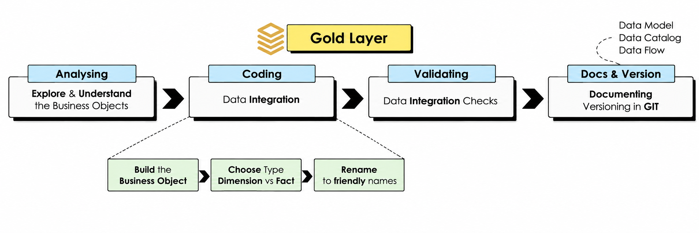
*Figure 12: Gold Layer lifecycle: Exploring business objects, Coding data integration views, Validating relationships, and Documenting.*

### Dimensional Modeling Concepts: Dimension vs. Fact

To support intuitive slicing and fast aggregation, the data is partitioned into Dimensions and Facts:

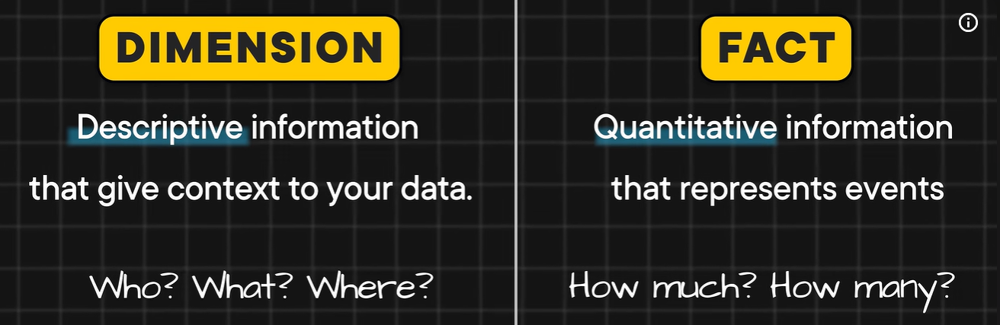
*Figure 13: Fundamental distinction between contextual Dimensions (Who? What? Where?) and quantitative Facts (How much? How many?).*

### Surrogate Keys

To insulate the analytical warehouse from operational schema changes, surrogate keys are generated for each dimension:


*Figure 14: Surrogate Key: System-generated integer identifier assigned to each record in dimension tables.*

### Kimball Star Schema Architecture

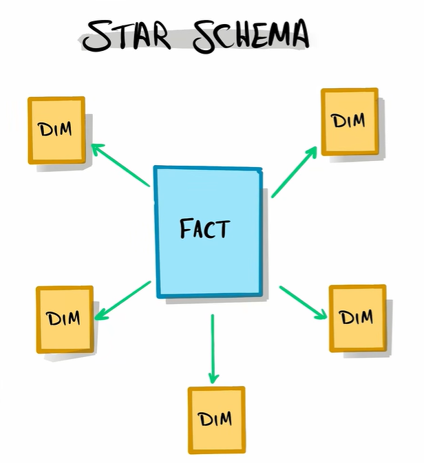
*Figure 15: Classical Star Schema architecture with central Fact surrounded by Conformed Dimensions.*

### Production Star Schema Implementation (Gold Views)

The production Star Schema is deployed using optimized SQL Views (`gold.dim_customers`, `gold.dim_products`, `gold.fact_sales`):


*Figure 16: Entity Relationship Diagram of Gold Layer Views detailing keys, attributes, and cardinality.*

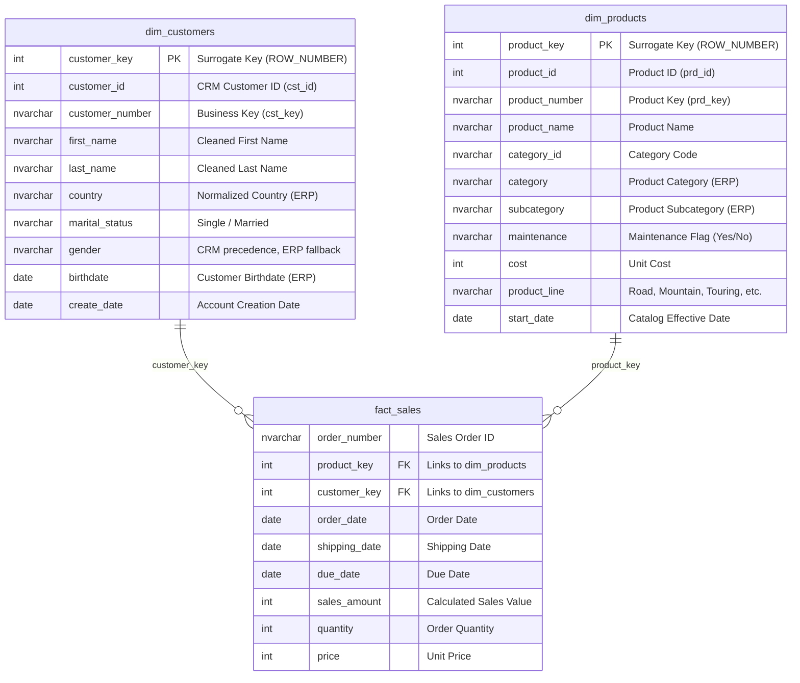

### Advanced Gold Layer Implementation Details:
1. **Surrogate Key Generation:** Built using `ROW_NUMBER() OVER (...)` to decouple warehouse analytics from operational primary keys.
2. **Conflict Resolution & Precedence:** Gender resolution uses CRM as primary; if missing or `'n/a'`, falls back to ERP:
   ```sql
   CASE
       WHEN ci.cst_gndr != 'n/a' THEN ci.cst_gndr
       ELSE COALESCE(ca.gen, 'n/a')
   END AS gender
   ```
3. **Active Catalog Filtering (SCD):** `dim_products` automatically filters out historical/superseded products using `WHERE pn.prd_end_dt IS NULL`.

---

## ⚙️ Data Quality & Validation Framework

A robust automated test suite ensures that data moving through the layers conforms to strict integrity constraints:

### 1. Silver Layer Integrity Tests ([`tests/quality_checks_silver.sql`](tests/quality_checks_silver.sql))
- **Primary Key Uniqueness & Non-Null:** Asserts no duplicates in `cst_id` or `prd_id`.
- **Whitespace Sanitization:** Asserts zero un-trimmed strings (`WHERE col != TRIM(col)`).
- **Domain Normalization:** Verifies categorical columns contain only allowed enumerations (`Single`, `Married`, `n/a`).
- **Mathematical Accuracy:** Enforces `sls_sales = sls_quantity * sls_price` across 100% of rows.
- **Chronological Validity:** Enforces `sls_order_dt <= sls_ship_dt` and `sls_order_dt <= sls_due_dt`.

### 2. Gold Layer Star Schema Tests ([`tests/quality_checks_gold.sql`](tests/quality_checks_gold.sql))
- **Surrogate Key Uniqueness:** Guarantees no duplicates in `customer_key` and `product_key`.
- **Referential Integrity & Orphan Check:** Performs joins between `fact_sales`, `dim_customers`, and `dim_products` asserting **zero orphan records**:
  ```sql
  SELECT *
  FROM gold.fact_sales f
  LEFT JOIN gold.dim_customers c ON c.customer_key = f.customer_key
  LEFT JOIN gold.dim_products p ON p.product_key = f.product_key
  WHERE p.product_key IS NULL OR c.customer_key IS NULL;
  -- Expectation: 0 rows returned
  ```

---

## 📂 Project Directory Structure

```plaintext
SQL_Data_Warehouse_Project/
│
├── datasets/                            # Raw source CSV datasets
│   ├── source_crm/                      # CRM Source System Extracts
│   │   ├── cust_info.csv                # Customer registration & basic profiles
│   │   ├── prd_info.csv                 # Product master catalog with historical dates
│   │   └── sales_details.csv            # Fact sales transactions
│   └── source_erp/                      # ERP Source System Extracts
│       ├── CUST_AZ12.csv                # Extended customer demographics (DOB, Gender)
│       ├── LOC_A101.csv                 # Customer geographical locations
│       └── PX_CAT_G1V2.csv              # Product category hierarchies & maintenance flags
│
├── diagrams/                            # Architecture blueprints, schemas, and pipeline charts
│   ├── Data_Architecture.png            # High-level warehouse architecture
│   ├── Data_Architecture_Pipelines.png  # Comparison of data architecture paradigms
│   ├── Table_Relation.png               # Cross-system entity relationship diagram
│   ├── ETL.png                          # Comprehensive ETL taxonomy mind map
│   ├── Data_Lineage.png                 # End-to-end table lineage & data flow
│   ├── Bronze_Layer.png                 # Bronze layer engineering lifecycle
│   ├── Bronze_Layer_Analysis.png        # Source system analysis & discovery framework
│   ├── Bulk_Insert.png                  # Bulk insert vs single row insert comparison
│   ├── Silver_Layer.png                 # Silver layer engineering lifecycle
│   ├── silver.crm_prd_info.png          # Product date correction case study
│   ├── silver.crm_sales_details.png     # Sales business rules & logic
│   ├── Gold_Layer.png                   # Gold layer engineering lifecycle
│   ├── Dimension_Fact.png               # Conceptual Dimension vs Fact model
│   ├── Surrogate_Key.png                # Surrogate key definition
│   ├── Star_Schema.png                  # Conceptual Star Schema diagram
│   └── Star_Schema_Views.png            # Detailed Gold Star Schema views ERD
│
├── scripts/                             # Production SQL scripts
│   ├── init_database.sql                # Database initialization & schema provisioning
│   ├── bronze/                          # Bronze layer DDL & Ingestion
│   │   ├── ddl_bronze.sql               # Bronze table definitions
│   │   └── proc_load_bronze.sql         # Stored procedure: BULK INSERT orchestration
│   ├── silver/                          # Silver layer DDL & Transformation
│   │   ├── ddl_silver.sql               # Silver table definitions with audit columns
│   │   └── proc_load_silver.sql         # Stored procedure: Cleansing, deduplication, rules
│   └── gold/                            # Gold layer DDL
│       └── ddl_gold.sql                 # Kimball Star Schema views & surrogate keys
│
└── tests/                               # Data quality assurance & verification suite
    ├── data_quality_check.sql           # Comprehensive exploratory data quality scripts
    ├── quality_checks_silver.sql        # Silver layer validation tests
    └── quality_checks_gold.sql          # Gold layer integrity & referential tests
```

---

## 🚀 Step-by-Step Setup & Execution Guide

### Prerequisites
* **Microsoft SQL Server 2019+** or **Azure SQL Managed Instance**
* **SQL Server Management Studio (SSMS)** or **Azure Data Studio**
* Filesystem access to load CSV files via `BULK INSERT`

### Execution Order

```sql
-- 1. Initialize Database and Schemas
-- Execute: scripts/init_database.sql

-- 2. Deploy Bronze Schema and Ingestion Procedure
-- Execute: scripts/bronze/ddl_bronze.sql
-- Execute: scripts/bronze/proc_load_bronze.sql

-- 3. Load Bronze Layer
EXEC bronze.load_bronze;

-- 4. Deploy Silver Schema and Transformation Procedure
-- Execute: scripts/silver/ddl_silver.sql
-- Execute: scripts/silver/proc_load_silver.sql

-- 5. Load Silver Layer
EXEC silver.load_silver;

-- 6. Deploy Gold Views
-- Execute: scripts/gold/ddl_gold.sql

-- 7. Run Quality & Integrity Verification Suite
-- Execute: tests/quality_checks_silver.sql
-- Execute: tests/quality_checks_gold.sql
```

> **Note on File Paths:** The `BULK INSERT` file paths in `scripts/bronze/proc_load_bronze.sql` point to the local `datasets/` directory. If deploying to another machine or server, update the `FROM '...'` path string accordingly.

---

## 📊 Analytical Insights & Business Queries

With the Gold Star Schema deployed, business users and BI analysts can easily answer high-impact questions:

### 1. Total Revenue, Orders, and Average Order Value (AOV) by Product Line
```sql
SELECT 
    p.product_line,
    COUNT(DISTINCT f.order_number) AS total_orders,
    SUM(f.quantity)                AS units_sold,
    SUM(f.sales_amount)            AS total_revenue,
    AVG(f.sales_amount)            AS avg_order_value
FROM gold.fact_sales f
JOIN gold.dim_products p 
    ON f.product_key = p.product_key
GROUP BY p.product_line
ORDER BY total_revenue DESC;
```

### 2. Top 10 Customers by Lifetime Value (LTV)
```sql
SELECT TOP 10
    c.customer_number,
    c.first_name + ' ' + c.last_name AS full_name,
    c.country,
    COUNT(DISTINCT f.order_number)   AS total_orders,
    SUM(f.sales_amount)              AS lifetime_spend
FROM gold.fact_sales f
JOIN gold.dim_customers c 
    ON f.customer_key = c.customer_key
GROUP BY c.customer_number, c.first_name, c.last_name, c.country
ORDER BY lifetime_spend DESC;
```

### 3. Geographical Sales Distribution by Product Category
```sql
SELECT 
    c.country,
    p.category,
    SUM(f.sales_amount) AS revenue,
    ROUND(100.0 * SUM(f.sales_amount) / SUM(SUM(f.sales_amount)) OVER(PARTITION BY c.country), 2) AS pct_of_country_sales
FROM gold.fact_sales f
JOIN gold.dim_customers c ON f.customer_key = c.customer_key
JOIN gold.dim_products p  ON f.product_key = p.product_key
GROUP BY c.country, p.category
ORDER BY c.country, revenue DESC;
```

---

## 🛠 Tech Stack & Engineering Practices

- **RDBMS Engine:** Microsoft SQL Server (T-SQL)
- **Data Architecture:** Medallion Architecture (Bronze ➔ Silver ➔ Gold)
- **Data Modeling:** Ralph Kimball Dimensional Modeling (Conformed Dimensions, Fact Tables, Star Schema)
- **Data Ingestion:** Batch Processing via `BULK INSERT` with `TABLOCK` for high-speed I/O
- **Orchestration:** Modular Stored Procedures (`load_bronze`, `load_silver`) with `@start_time`, `@end_time` performance telemetry and structured `TRY...CATCH` exception handling
- **Data Governance:** Audit columns (`dwh_create_date`), source-of-truth precedence logic, surrogate key management

---

## 👤 Author & Acknowledgments

* **Project:** Enterprise SQL Data Warehouse & ETL Pipeline
* **Data Sources:** Synthesized Multi-System Enterprise Data (CRM & ERP)
* **Contributions & Feedback:** Open for contributions via Pull Requests or Issues!

