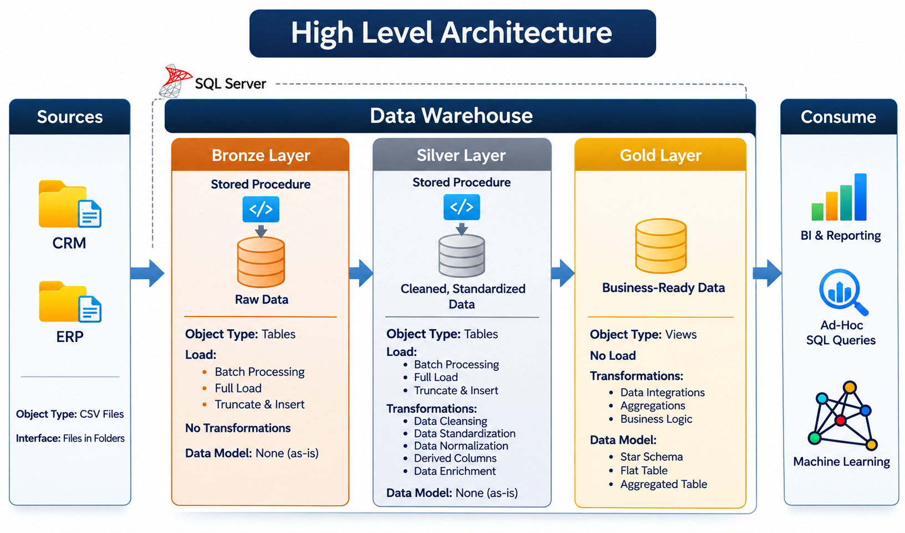
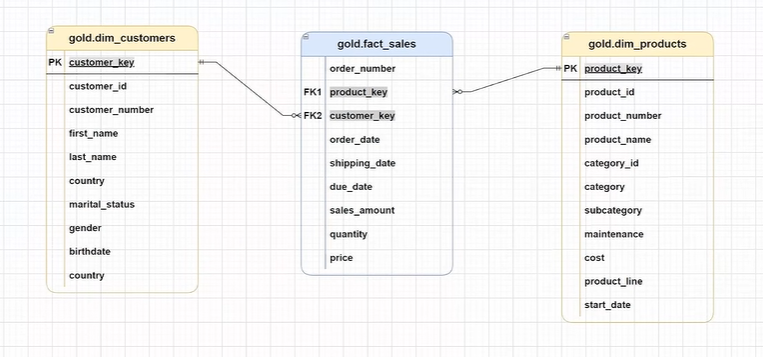

<div align="center">

# 🏢 Enterprise SQL Data Warehouse & ETL Pipeline
### Production-Grade Medallion Architecture (Bronze ➔ Silver ➔ Gold) with Microsoft SQL Server

[](https://www.microsoft.com/sql-server)
[](https://docs.microsoft.com/sql/t-sql/)
[-00A389?style=flat&logo=databricks&logoColor=white)](#-medallion-architecture)
[](#-gold-layer-star-schema--dimensional-views)
[](#-data-quality--integrity-suite)
[](LICENSE)

<p align="center">
  <b>An end-to-end enterprise data warehouse consolidating disparate CRM and ERP operational systems into conformed dimensions and Kimball Star Schema views for high-performance BI analytics.</b>
</p>

</div>

---

## 📖 Overview

Organizations frequently struggle with siloed transactional systems that produce contradictory metrics. This project implements a modern **Enterprise Data Warehouse** on **Microsoft SQL Server**, consolidating operational records from two independent enterprise systems:
- **CRM:** Customer profiles, product catalogs, and raw sales transaction records.
- **ERP:** Customer demographics, geographic locations, and product categorization hierarchies.

Following the **Medallion Architecture**, raw records are ingested into **Bronze**, conformed and cleansed in **Silver**, and exposed as an optimized **Kimball Star Schema in Gold** for downstream business intelligence.

---

## 🏛️ Medallion Architecture



```
┌──────────────────────────────────────────────┐
│          1. BRONZE LAYER (RAW STAGING)       │
│  • Stored Procedure: bronze.load_bronze      │
│  • High-throughput BULK INSERT with TABLOCK  │
│  • Zero-loss staging of raw CRM & ERP CSVs   │
└──────────────────────┬───────────────────────┘
                       │
                       ▼
┌──────────────────────────────────────────────┐
│       2. SILVER LAYER (CLEANSE & CONFORM)    │
│  • Stored Procedure: silver.load_silver      │
│  • Overlapping date fixing via LEAD()        │
│  • Recalculating corrupt sls_sales amounts   │
│  • Standardizing genders, status & ISO codes │
│  • Audit metadata: dwh_create_date           │
└──────────────────────┬───────────────────────┘
                       │
                       ▼
┌──────────────────────────────────────────────┐
│     3. GOLD LAYER (KIMBALL STAR SCHEMA)      │
│  • Views: gold.dim_customers & dim_products  │
│  • Fact:  gold.fact_sales                    │
│  • Integer Surrogate Keys (ROW_NUMBER)       │
│  • Direct compatibility with Power BI & OLAP │
└──────────────────────────────────────────────┘
```

---

## 🔄 Source Systems & Data Lineage

The warehouse unifies six primary transactional files across operational domains:

| Source System | File Name | Target Entity | Core Cleansing & Transformations Applied |
| :--- | :--- | :--- | :--- |
| **CRM** | `cust_info.csv` | Customer Profiles | Whitespace trimming, marital status standardization (`M`/`S`), gender standardization |
| **CRM** | `prd_info.csv` | Product Catalog | Inverted start/end dates, missing end dates resolved via `LEAD()` |
| **CRM** | `sales_details.csv` | Sales Transactions | Zero/negative sales corrected via `sls_quantity * ABS(sls_price)` |
| **ERP** | `CUST_AZ12.csv` | Demographics | Key prefix stripping (`NAS...`), birthdate casting, fallback gender resolution |
| **ERP** | `LOC_A101.csv` | Customer Geographies | Harmonizing disparate country names (`US`, `USA` ➔ `United States`, `DE` ➔ `Germany`) |
| **ERP** | `PX_CAT_G1V2.csv` | Product Categories | Product hierarchy category, subcategory, and maintenance classification |

---

## 🔬 Core Engineering Highlights

### 1. Inverted Date Normalization via Window Functions (Silver)
In the raw product catalog, historical versions frequently contained inverted or overlapping dates. The Silver ETL dynamically computes accurate version validity using `LEAD()`:

```sql
SELECT 
    prd_id,
    prd_key,
    prd_nm,
    prd_cost,
    prd_line,
    prd_start_dt,
    -- Derive valid end date from the next version's start date
    DATEADD(day, -1, 
        LEAD(prd_start_dt) OVER (
            PARTITION BY prd_key 
            ORDER BY prd_start_dt
        )
    ) AS prd_end_dt
FROM bronze.crm_prd_info;
```

### 2. Business Arithmetic & Price Derivations (Silver)
Corrupted transactions with negative prices or mismatched totals are recalculated automatically:

```sql
CASE 
    WHEN sls_sales IS NULL OR sls_sales <= 0 OR sls_sales != sls_quantity * ABS(sls_price)
        THEN sls_quantity * ABS(sls_price)
    ELSE sls_sales
END AS sls_sales
```

### 3. Kimball Star Schema Views (Gold)



Surrogate keys are generated dynamically in dimension views using deterministic window indexing:
- **`gold.dim_customers`**: Unifies CRM customer profiles with ERP demographics and country codes (`ROW_NUMBER() OVER (ORDER BY cst_id)`).
- **`gold.dim_products`**: Combines CRM product lines with ERP category hierarchies (`WHERE prd_end_dt IS NULL`).
- **`gold.fact_sales`**: Central transaction fact joining dimension surrogate keys to deliver instant analytics without data duplication.

---

## ⚙️ Data Quality & Integrity Suite

Automated test scripts in [`tests/quality_checks_silver.sql`](tests/quality_checks_silver.sql) and [`tests/quality_checks_gold.sql`](tests/quality_checks_gold.sql) validate schema integrity:

```sql
-- 1. Verify Zero Surrogate Key Duplication
SELECT customer_key, COUNT(*) AS duplicates
FROM gold.dim_customers
GROUP BY customer_key
HAVING COUNT(*) > 1;

-- 2. Star Schema Referential Integrity (Zero Orphan Fact Rows)
SELECT COUNT(*) AS orphan_sales_records
FROM gold.fact_sales f
LEFT JOIN gold.dim_customers c ON f.customer_key = c.customer_key
LEFT JOIN gold.dim_products p  ON f.product_key = p.product_key
WHERE c.customer_key IS NULL OR p.product_key IS NULL;

-- 3. Chronological Consistency
SELECT COUNT(*) AS invalid_order_dates
FROM gold.fact_sales
WHERE order_date > shipping_date;
```

---

## 📊 Analytical Insights

```sql
-- Top 5 Customers by Lifetime Value (LTV)
SELECT TOP 5
    c.customer_number,
    c.first_name + ' ' + c.last_name AS full_name,
    c.country,
    COUNT(DISTINCT f.order_number)   AS total_orders,
    SUM(f.sales_amount)              AS lifetime_spend
FROM gold.fact_sales f
JOIN gold.dim_customers c ON f.customer_key = c.customer_key
GROUP BY c.customer_number, c.first_name, c.last_name, c.country
ORDER BY lifetime_spend DESC;
```

---

## 📂 Repository Structure

```text
sql-data-warehouse-project/
├── database/
│   ├── source_crm/                      # Raw CRM CSVs (cust_info, prd_info, sales)
│   └── source_erp/                      # Raw ERP CSVs (CUST_AZ12, LOC_A101, PX_CAT)
├── diagrams/                            # Architecture and schema lineage diagrams
├── scripts/
│   ├── init_database.sql                # Creates DataWarehouse and bronze/silver/gold schemas
│   ├── bronze/
│   │   ├── ddl_bronze.sql               # Bronze table DDLs
│   │   └── proc_load_bronze.sql         # Bulk insert procedure with telemetry
│   ├── silver/
│   │   ├── ddl_silver.sql               # Silver table DDLs
│   │   └── proc_load_silver.sql         # Cleansing & conforming procedure
│   └── gold/
│       └── ddl_gold.sql                 # Star schema analytical views
├── tests/
│   ├── quality_checks_silver.sql        # Silver layer validation suite
│   └── quality_checks_gold.sql          # Gold star schema integrity tests
├── README.md
└── LICENSE
```

---

## 🚀 Setup & Execution Guide

### Execution Sequence
1. **Initialize Database:** Run [`scripts/init_database.sql`](scripts/init_database.sql) to provision the `DataWarehouse` database and schemas.
2. **Deploy Table DDLs:** Run `scripts/bronze/ddl_bronze.sql` and `scripts/silver/ddl_silver.sql`.
3. **Compile Stored Procedures:** Run `scripts/bronze/proc_load_bronze.sql` and `scripts/silver/proc_load_silver.sql`.
4. **Trigger Ingestion & Transformation:**
   ```sql
   EXEC bronze.load_bronze;  -- Loads CSVs into raw staging
   EXEC silver.load_silver;  -- Cleanses, standardizes, and conforms
   ```
5. **Deploy Analytical Views:** Run [`scripts/gold/ddl_gold.sql`](scripts/gold/ddl_gold.sql) to create the Kimball Star Schema views.
6. **Run Quality Validation:** Execute `tests/quality_checks_gold.sql` to confirm zero schema or referential integrity errors.

---

<div align="center">

### 👨‍💻 Connect with the Author

**Lavansh Jindal**  
*Data Analyst | Software Developer | Full-Stack Developer | Business Intelligence Analyst*

[](https://lavansh-jindal.vercel.app)
[](https://github.com/lavansh4725)
[](https://www.linkedin.com/in/lavansh-jindal/)
[](https://leetcode.com/u/lavansh_0395/)
[](mailto:lavansh4725jindal@gmail.com)

<sub>*"Bridging full-stack software development and data analytics — architecting resilient dimensional data warehouses, intelligent GenAI platforms, and high-impact business intelligence."*</sub>

</div>
